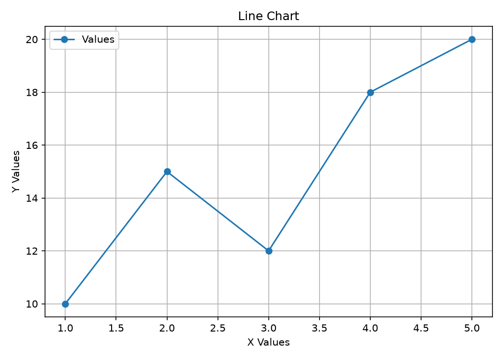
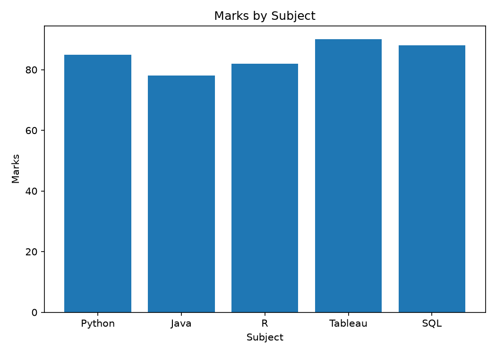
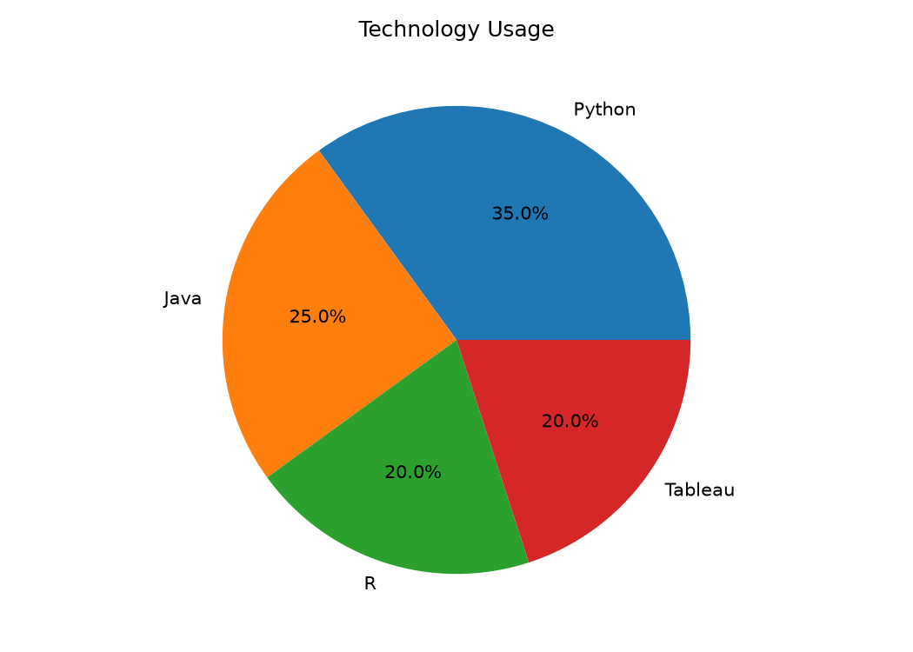
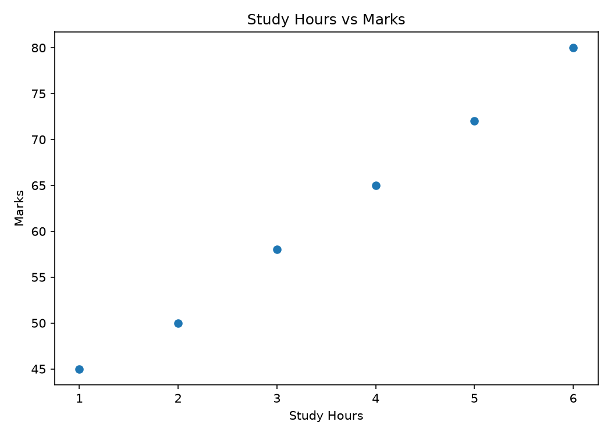
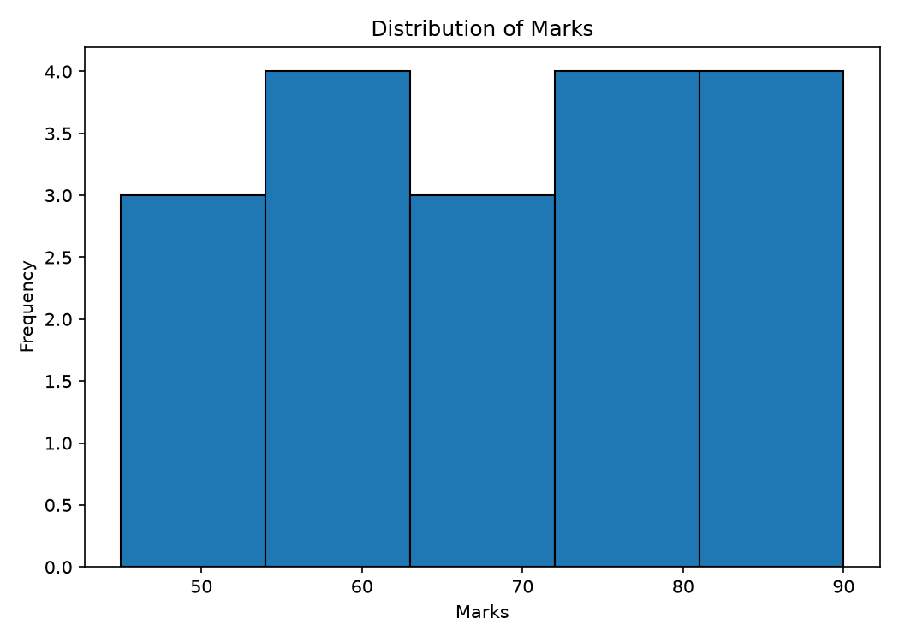

# Experiment 2: Basic Visualization in Python

`program.py` generates five Matplotlib figures:

| Preview | Image |
| --- | --- |
| Line chart |  |
| Bar chart |  |
| Pie chart |  |
| Scatter plot |  |
| Histogram |  |

Generated files are stored in this experiment's `outputs/` directory.
