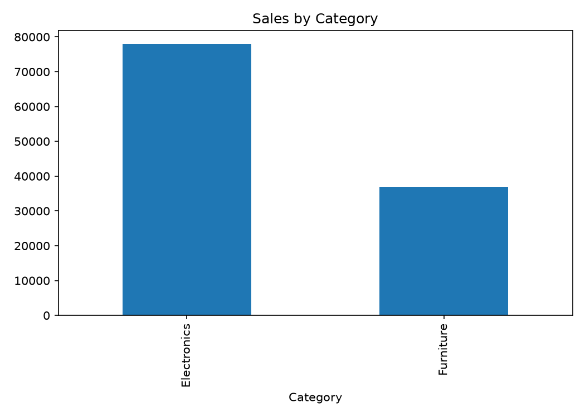
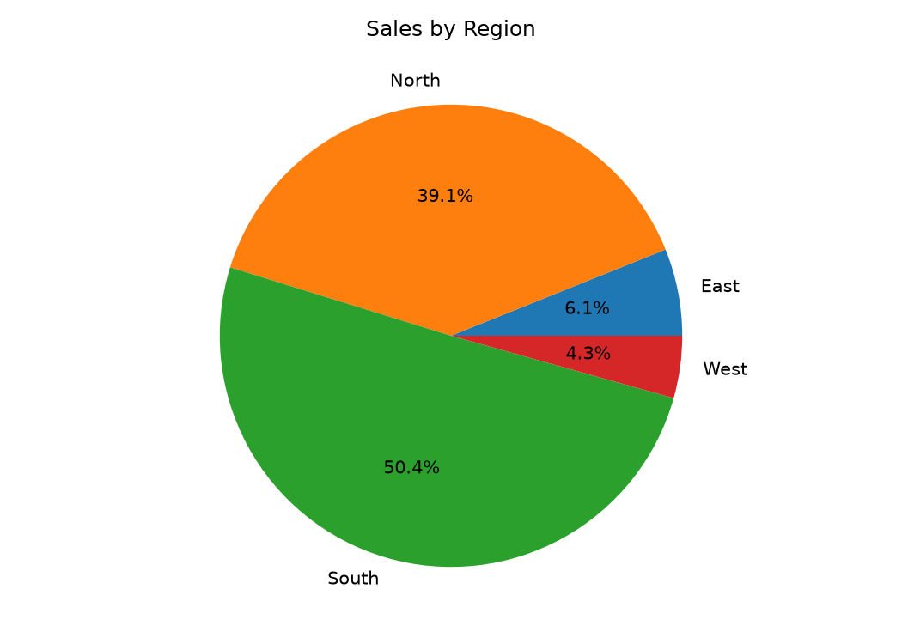
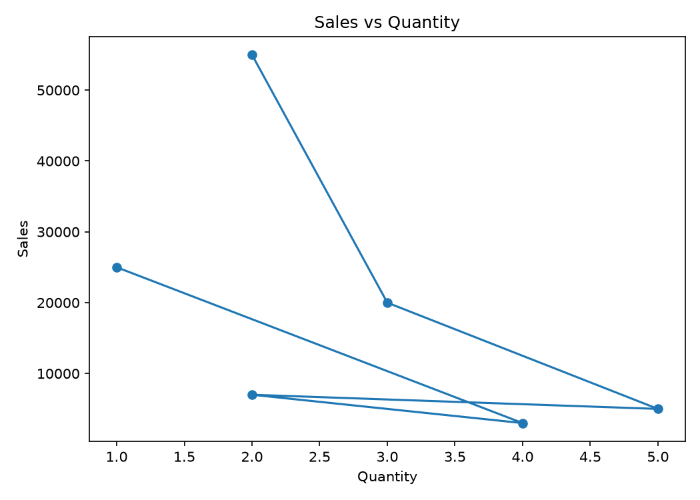

# Experiment 8: Charts, Graphs, and Data Mapping

The companion charts generated from the sample sales data are:

| Chart | Preview |
| --- | --- |
| Sales by category |  |
| Sales by region |  |
| Sales versus quantity |  |

Generated files are stored in `outputs/`.
