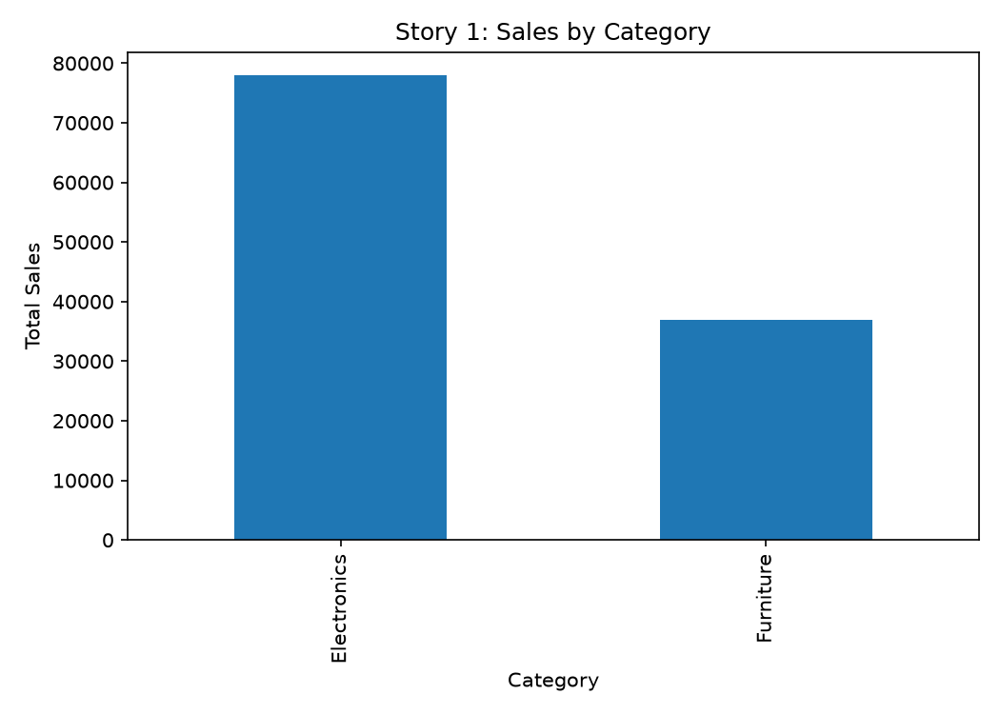
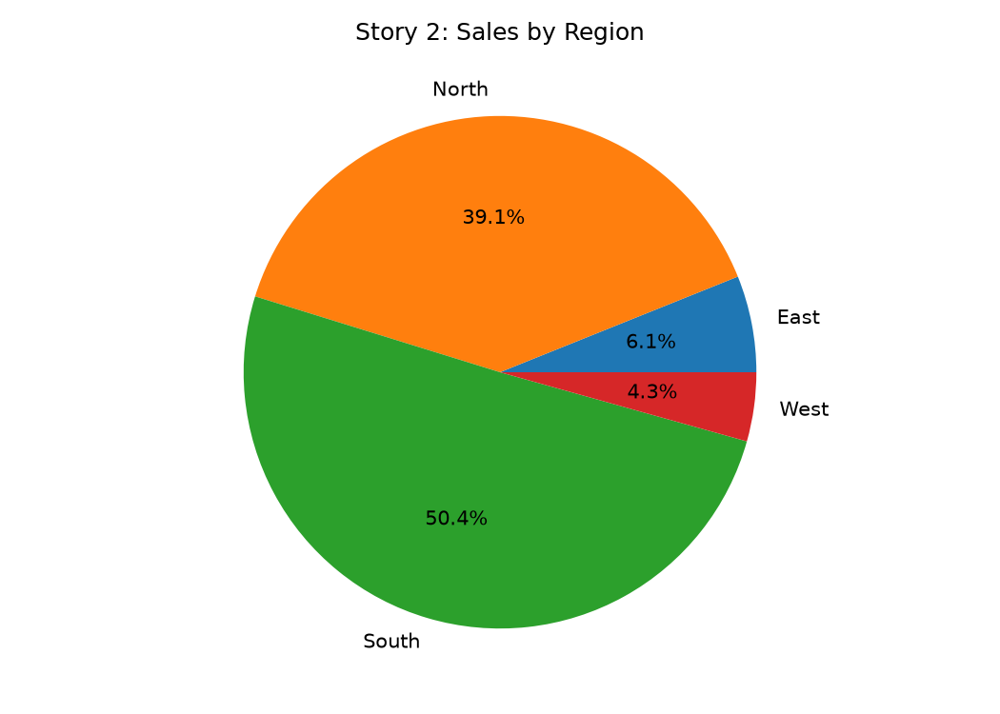
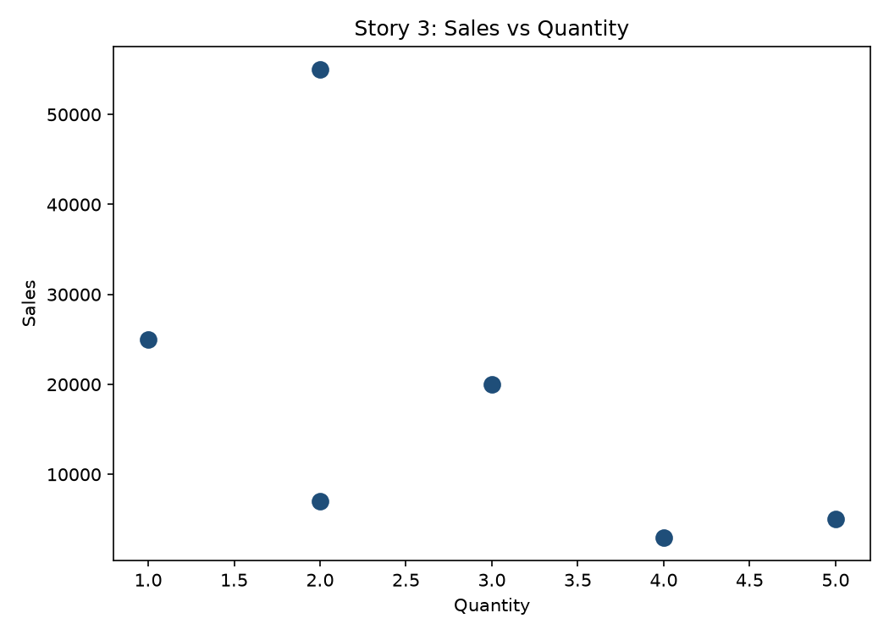

# Experiment 10: Storytelling in Tableau

The program exports three story views:

| Story view | Preview |
| --- | --- |
| Category performance |  |
| Regional contribution |  |
| Sales versus quantity |  |

Generated files are stored in `outputs/`.
